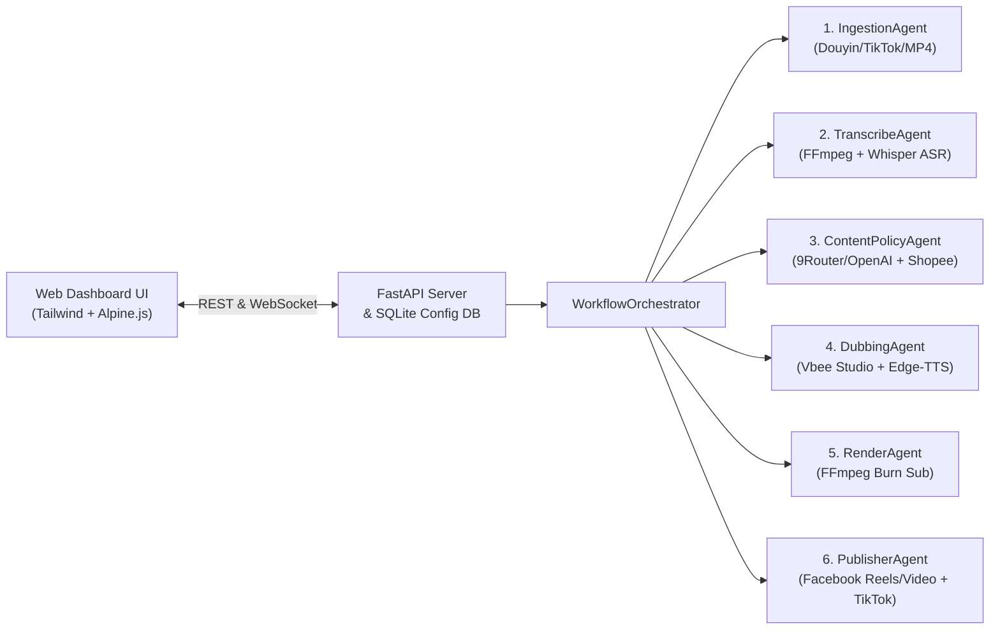

# 🎬 Reup Automation — AI Video Subber, Dubbing & Multi-Channel Publisher

Hệ thống **All-in-One Multi-Agent** tự động hóa hoàn toàn quy trình tải video Douyin/TikTok không logo $\rightarrow$ Bóc tách phụ đề (ASR Whisper) $\rightarrow$ AI Dịch tiếng Việt & Viết tiêu đề/caption né từ khóa vi phạm chính sách $\rightarrow$ Tự động tìm kiếm link Shopee Affiliate $\rightarrow$ Lồng tiếng AI (Vbee Studio / Edge-TTS miễn phí) $\rightarrow$ Render & Burn phụ đề nghệ thuật bằng FFmpeg $\rightarrow$ Tự động xuất bản lên **Facebook Reels / Fanpage Video** và **TikTok**.

---

## ✨ Kiến trúc Multi-Agent (6 Agents chuyên biệt)



1. **IngestionAgent**: Trích xuất URL sạch từ văn bản chia sẻ Douyin/TikTok, gỡ rút gọn link và tải video gốc chất lượng cao qua `yt-dlp` hoặc stream trực tiếp.
2. **TranscribeAgent**: Tách âm thanh chuẩn 16kHz MP3 và gọi API Whisper (`ShopAIKey`, `Groq`, `OpenAI`) để tạo phụ đề `.srt` gốc.
3. **ContentPolicyAgent**:
   - Dịch phụ đề `.srt` sang tiếng Việt tự nhiên chuẩn thoại phim, giữ nguyên 100% mốc thời gian.
   - Tự động viết **Tiêu đề IN HOA giật gân**, **Caption cuốn hút**, **Hashtags xu hướng**.
   - **Bộ lọc an toàn chính sách (Policy Sanitizer)**: Tự động thay thế từ nhạy cảm tránh gậy TikTok/Facebook (*chết $\rightarrow$ đăng xuất*, *đánh/chém $\rightarrow$ tác động vật lý*, *tự tử $\rightarrow$ nghĩ quẩn*...).
   - Tự động tìm sản phẩm bán chạy trên **Shopee** và gắn `sub_id` Affiliate.
4. **DubbingAgent**: Lồng tiếng khớp phụ đề qua **Vbee Studio API**; tự động chuyển đổi dự phòng (failover) sang **Microsoft Edge-TTS** (`vi-VN-HoaiMyNeural`, `vi-VN-NamMinhNeural` miễn phí 100%) nếu thiếu hoặc hết hạn cookie Vbee.
5. **RenderAgent**: Dùng FFmpeg ghép giọng lồng tiếng và burn phụ đề vàng viền đen nổi bật lên video.
6. **PublisherAgent**:
   - **Facebook Publishing**: Hỗ trợ cả giao thức **Facebook Reels 3 bước** (`/{page-id}/video_reels`: `start` $\rightarrow$ binary upload $\rightarrow$ `finish`) và đăng **Video Fanpage thường** (`/{page-id}/videos`), tự động fallback nếu Fanpage chưa mở Reels API.
   - **TikTok Publishing**: Kết nối Webhook (n8n/Make) hoặc Session ID.

---

## 🚀 Cài đặt 1 dòng lệnh trên VPS (One-Command Deploy)

Trên máy chủ Linux VPS (Ubuntu/Debian), chỉ cần chạy **1 lệnh duy nhất**:

```bash
git clone https://github.com/DoanDuyThanh71/reup-automation.git && cd reup-automation && bash install.sh
```

Hoặc khởi chạy trực tiếp với **Docker Compose**:

```bash
cp .env.example .env && docker compose up -d --build
```

Sau khi cài xong, mở trình duyệt truy cập:
👉 **`http://<IP_VPS_CỦA_BẠN>:8000`**

---

## 🔑 Cấu hình Token & Endpoint trực tiếp trên Giao diện Web

Không cần chỉnh sửa file trên terminal! Truy cập tab **"Cấu hình Token & API"** trên giao diện Web để điền và kiểm tra kết nối trực tiếp:

| Nhóm cấu hình | Các thông số hỗ trợ | Nút kiểm tra |
|---|---|---|
| **Facebook Reels & Fanpage** | `FACEBOOK_PAGE_ID`, `FACEBOOK_PAGE_ACCESS_TOKEN`, Chế độ đăng (`reel` / `video`), Tự động đăng (`true` / `false`) | **Kiểm tra kết nối** (Trả về tên Fanpage & ID) |
| **Mô hình AI Dịch & SEO** | `AI_BASE_URL` (mặc định `https://9router.n8n71.com/v1` hoặc OpenAI/Groq), `AI_MODEL` (`AiFF`, `gpt-4o-mini`...), `AI_API_KEY` | **Test AI** |
| **Lồng tiếng AI (TTS)** | `TTS_PROVIDER` (`vbee` / `edge-tts`), `VBEE_REFRESH_TOKEN_COOKIE`, `VBEE_VOICE_CODE`, `EDGE_TTS_VOICE` | **Test Vbee** |
| **Bóc tách phụ đề (ASR)** | `ASR_PROVIDER` (`shopaikey`, `groq`, `openai`, `local`), `ASR_BASE_URL`, `ASR_API_KEY`, `ASR_MODEL` | **Test ASR** |
| **Shopee Affiliate & TikTok** | `SHOPEE_SUB_ID`, `SHOPEE_COOKIE`, `DOUYIN_COOKIE`, `TIKTOK_WEBHOOK_URL`, `TIKTOK_SESSION_ID` | **Test Shopee** |

> Mọi thay đổi trên giao diện Web được lưu trực tiếp vào cơ sở dữ liệu SQLite (`data/reup_automation.db`) và **có hiệu lực ngay lập tức** mà không cần khởi động lại container.

---

## 💻 Chạy thử nghiệm trên máy cá nhân (Windows / macOS / Linux)

```bash
python -m venv .venv
# Windows:
.venv\Scripts\activate
# Linux/macOS:
source .venv/bin/activate

pip install -r requirements.txt
python run.py
```

Mở trình duyệt tại: `http://localhost:8000`

---

## 🧪 Chạy bộ kiểm thử tự động (Automated Pytest Suite)

Bộ kiểm thử sử dụng mock 100% cho các dịch vụ bên ngoài (Facebook Graph API, 9Router/OpenAI, Vbee, Edge-TTS, Douyin, Shopee, FFmpeg), chạy hoàn toàn offline không cần API key thật:

```bash
pytest -v
```
